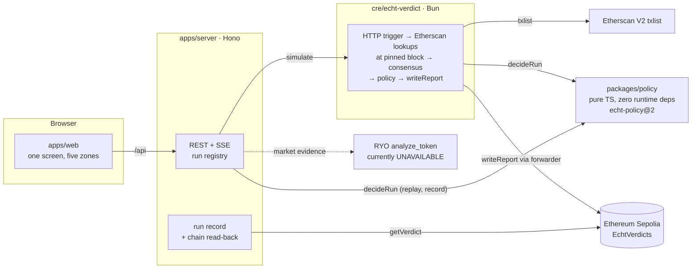

# Architecture

Echt is one screen over one check. The check is a Chainlink CRE workflow that reads transfer history at a pinned block, runs a deterministic policy, and writes the verdict to `EchtVerdicts` on Ethereum Sepolia. Everything else exists to feed that check and to show its result.

## Components



## Data flow for one check

```mermaid
sequenceDiagram
    participant O as Operator (browser)
    participant S as Server
    participant W as CRE workflow
    participant E as Etherscan
    participant C as EchtVerdicts
    O->>S: POST /api/runs/T1 (dry or ?broadcast=true)
    S->>S: load scenario · refuse unfilled or future posts · pin = head − 20
    S->>W: cre workflow simulate --http-payload
    loop each voice wallet (paced 400 ms)
      W->>E: txlist, startblock = postBlock − 21600, endblock = pinned
    end
    W->>W: policy: campaign sources → qualifying transfers → verdict
    loop each campaign source (≤ 5)
      W->>E: txlist, count
    end
    W->>C: writeReport(Verdict)
    S->>C: getVerdict(runId) read-back
    S->>S: recompute evidence hash; write scenarios/runs/T1.json only if all agree
    S-->>O: SSE log, result, record
```

## CRE limits

The workflow stays inside the CRE limits in CLAUDE.md §8.

| Limit | CRE hard limit | Echt budget | How Echt stays inside |
|---|---|---|---|
| HTTP calls per execution | 15 | ≤ 12 | 7 voice lookups, then at most 5 source lookups (D13) |
| HTTP response size | 250 KB | ≤ 250 KB | Each lookup keeps only the transfer fields the policy reads |
| Workflow response | 100 KB | small | The workflow returns a short JSON summary |
| Execution time | 5 min | well under | Calls are paced at 400 ms to respect Etherscan's 3/s limit (D12) |
| EVM log reads | 100 blocks | not used | Transfer history comes over HTTP, never `eth_getLogs` |
| Determinism | no `Date.now`, `Math.random`, `Promise.race` | enforced | Times come in the payload; the only clock is the block timestamp in the data |
| Consensus | identical output across nodes | by construction | Pinned `endblock`, sorted rows, errors returned as data (D14) |

## Decisions

Full text and dates are in `docs/DECISIONS.md`. Summary:

| # | Decision |
|---|---|
| D1 | RFC 8785 canonical JSON and a pure-TS SHA-256 live in `packages/policy`, so the CRE workflow runs the same hash code. `canonicalize` is a devDependency, used only in tests |
| D2 | Synthetic posts sit 8–14 h after their persona's real payment block timestamp. All T1 posts fall in one 6 h window. `postBlock` is filled only after the post time passes |
| D3 | Attestations are real `signed_challenge` signatures for all 14 personas. Each scenario picks its verified set |
| D4 | CRE config is `config.echt.json`. `config.staging.json` and `config.production.json` are never edited |
| D5 | BLOCK = at least 3 undisclosed linked voices. Disclosed links are shown but do not count (approved) |
| D6 | A campaign source is a sender whose transfers reach at least 2 converging voices (approved). One payment is not enough, so T2 is ELIGIBLE with 0 linked voices |
| D7 | Hardhat 3, Solidity 0.8.28, mock forwarder as constructor argument |
| D8 | CRE SDK pinned to 1.23.0. Secret `ETHERSCAN_KEY`. The URL carrying the key is never logged |
| D9 | `main.ts` exports only `main()`. Helpers live in `run.ts` because the WASM build rejects exported functions with parameters |
| D10 | Chain scripts live in `scripts/`. pnpm 12.3.4 left some peer links broken (viem's `abitype`). Superseded by D21: the repo pins pnpm 10, and `viem` is a server dependency again |
| D11 | `cre workflow simulate --skip-type-checks`. The generated tsconfig rejects `.ts` import suffixes used by the policy package |
| D12 | 400 ms pacing before each Etherscan call (free tier allows 3 calls per second) |
| D13 | Two passes: voice lookups, then source lookups. At most 12 calls |
| D14 | Failed lookups come back as data. The policy turns them into REVIEW, never ELIGIBLE |
| D15 | The report is the ABI-encoded `Verdict`. Persona IDs are hashed on-chain. The evidence hash is `hashCanonical` of the evidence object |
| D16 | The server simulates by default and broadcasts only with `?broadcast=true`. It refuses unfilled or future posts before any CRE call |
| D17–D20 | Real runs are written only after the chain read-back agrees; the open-position state needs a real RYO envelope; `viem` (see D21); T2 is ELIGIBLE with 0 linked voices |
| D21 | pnpm pinned to 10.34.9 in `packageManager`; `viem` and `openai` are normal server dependencies |
| D22 | F2 extraction: `openai` SDK in JSON mode, zod validation, one retry, cache by sha256(text + model + promptVersion), labelled `MODEL` |

## Packages and where the logic lives

- `packages/policy`: `analyzePayments`, `judgePayment`, `evaluate`, and `decideRun`, the single function that the CRE workflow, the server's record builder and the browser Replay all call.
- `cre/echt-verdict/echt-verdict`: HTTP trigger, paced Etherscan lookups, `writeReport`. Pure helpers in `run.ts`.
- `apps/server`: run registry, SSE log, record and evidence endpoints, the read-back that decides whether a real run is written, and the F2 extraction.
- `apps/web`: the dashboard and the Evidence Brief. Plain React and CSS tokens. Replay runs `decideRun` in the browser.
- `contracts`: `EchtVerdicts.sol`, forwarder-only and idempotent by run id.
- `scripts`: seeding, attestations, post scheduling, run records, RYO retry, and the chain read used by the server.
