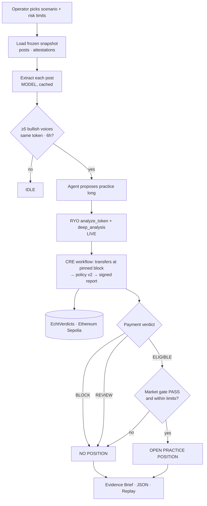
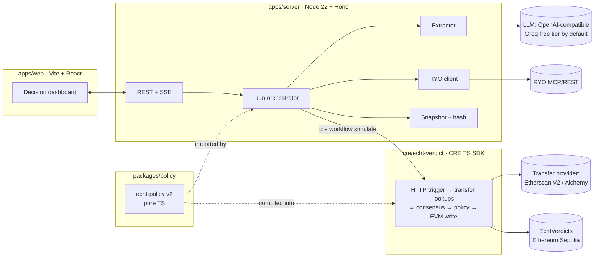

# Echt — Product Requirements Document

| | |
|---|---|
| **Version** | 0.6 (supersedes Project Brief v0.1 and decision rule v1) |
| **Status** | Approved for build |
| **Date** | Tue 27 Oct 2026 (Lagos, UTC+1) |
| **Chain** | Ethereum Sepolia (chain id 11155111). Base Sepolia dropped: Etherscan's API marks it "Paid Tier Only" |
| **Appetite** | 4 days to the BLI submission (Tue 27 evening → Sat 31 Oct); 1–11 Nov hardening for the RYO-CHAN Hackathon |
| **Primary entry** | BLI Legal Tech Hackathon 2 — Chainlink CRE bounty + legal track |
| **Secondary entry** | RYO-CHAN Hackathon 2026 — Track 1 Autonomous Agents + Track 2 Dashboards & Interfaces |
| **Inputs** | *Echt — Competitive Review & Winning-Entry Upgrade Plan* (24 Oct); RYO Builder MCP Guide (13 Aug 2026); CRE docs |
| **Owners** | Integration (CRE, contract, replay) · Agent & data (policy, RYO, attestation) · UI & demo · Cold-run reviewer (not a builder) |

> **Pitch:** Echt stops an AI trading agent from following coordinated crypto hype before it places a practice trade.
> **Hook:** *Seven bullish voices. One funding wallet. The agent changed its mind.*

---

## 0. How this PRD was written

What separates a buildable PRD from a generic one, and how each lesson is applied here:

| Practice | Source | Applied in |
|---|---|---|
| Fix the time budget ("appetite") before scope; list rabbit holes and no-gos up front | Basecamp Shape Up, via [prodmgmt.world](https://www.prodmgmt.world/blog/prd-template-guide) | Header, §12, §14 |
| Start from the customer outcome and work backwards | Amazon PR/FAQ (same guide) | Pitch, §1 |
| Explicit non-goals; staged sign-off | Square (same guide) | §12, §15 |
| Legal and privacy review as a required field | Uber (same guide) | §8.3, §15 |
| Every requirement is observable and testable; open questions have named owners; length only as clarity requires | [Plane](https://plane.so/blog/how-to-write-a-prd-that-engineers-actually-read) | §6, §11, §16 |
| Goals kept separate from requirements; assumptions stated; definition of done; versioning | [Centercode](https://www.centercode.com/blog/5-common-prd-mistakes-and-how-to-fix-them) | §2, §3, §11, changelog |
| Executable commands, project structure, and Always / Ask first / Never boundaries | spec-driven-development skill (Addy Osmani agent-skills) | §9.6, §9.7, §13 |

**Anti-patterns this PRD avoids:** feature wishlists, adjectives with no number attached, solutions with no user context, and silent assumptions.

---

## 1. Problem

Crypto influencers are routinely paid to promote tokens, and almost none of them disclose it.
- A leaked 2025 campaign sheet showed ~160 influencers accepting paid posts, fewer than 5 labelled as ads, with on-chain payment receipts ([The Block](https://www.theblock.co/post/368956/zachxbt-says-over-100-crypto-influencers-accepted-promo-deals-without-disclosing-paid-ads)).
- Tokens these influencers recommended averaged **−18.9% after 90 days** ([ProMarket](https://www.promarket.org/2023/04/17/crypto-influencers-give-poor-investment-advice-and-the-sec-is-taking-notice/)).

AI trading agents make this worse. RYO's own spotlight brief tells agents to treat **convergence of trusted voices** as a signal. A naive agent therefore converts a paid campaign into an automatic buy.

**Today's tools see one half of the picture:**

| Sees | Example | Misses |
|---|---|---|
| Speech | Text classifiers, coordination detectors | Payments |
| Money | Bubblemaps, Arkham | Speech |
| Both | Manual investigators (ZachXBT) | Speed: one case at a time, after the losses |

**Gap:** nothing checks, *at the moment an agent is about to act*, whether "independent" voices share a funding trail. Nothing gives a skeptical human an evidence pack they can audit afterwards.

---

## 2. Goals

| ID | Goal | Who it serves |
|---|---|---|
| G1 | The agent visibly changes its own decision when payment evidence undermines its signal | RYO Track 1 (cause and effect, repeatability) |
| G2 | The payment check runs as a Chainlink CRE workflow: external transfer data at a pinned block → deterministic verdict → on-chain write | Chainlink CRE bounty |
| G3 | The output is an auditable Evidence Brief that never alleges illegality | BLI legal judges |
| G4 | A judge understands what changed and why within 30 seconds, with sound off | RYO Track 2; muted demo video |
| G5 | Failure is honest: missing or inconsistent data produces `REVIEW`, never a false all-clear | RYO common score: coping with failure (20%) |

## 3. Success metrics (definition of done for the entry)

| ID | Metric | Target | How it's measured |
|---|---|---|---|
| M1 | Test-matrix scenarios returning the expected final action (§10.1) | **6 / 6** | `pnpm test:scenarios` |
| M2 | Replay of an unmodified snapshot reproduces the evidence hash and verdict | **100%** of runs | Replay endpoint plus CI test |
| M3 | Tampered snapshot detected | **100%** (any 1-byte change) | Tamper test |
| M4 | Baseline comparison: naive convergence agent vs Echt on the BLOCK scenario | Naive opens a position; Echt does not | Side-by-side run in the README, with denominators |
| M5 | Cold-run by the reviewer: clone to completed demo run | **≤ 5 commands, ≤ 15 min**, on Windows | Reviewer log |
| M6 | Muted comprehension: three people who have never seen Echt watch the dashboard without sound | **3 / 3** state the final action *and* the reason within 30 s | Hallway test, Day 6 |
| M7 | Secrets in git history | **0** | `gitleaks detect` |
| M8 | On-chain proof for BLOCK and ELIGIBLE runs | 2 verdict transactions on Ethereum Sepolia | Explorer links in the README |
| M9 | RYO failure path exercised (429 or `unavailable`) | Shown in the demo and the test log | Fault-injection flag |

No performance claims beyond these. No P&L claims: RYO's rubric explicitly does not score short-term P&L.

---

## 4. Users and user stories

**Primary user: the agent operator.** A research trader supervising an autonomous *practice*-trading agent. They want the agent to act on social signals without being farmed by paid campaigns. They need to know *why* it acted.

**Secondary user: the reviewer.** A compliance analyst, lawyer or journalist who receives an Evidence Brief and must decide whether a pattern deserves investigation. They need sources, timestamps, block numbers, limitations, and a way to verify nothing was altered.

**Tertiary user: the judge.** Sees a 2-minute video or a live run. Needs the reveal to be legible with sound off.

| ID | Story | Priority |
|---|---|---|
| US1 | As an operator, I configure a watchlist of up to 20 voices and risk limits, so the agent watches who *I* trust | Must |
| US2 | As an operator, when ≥5 watched voices converge bullish on one token, the agent proposes a practice position with its reasoning | Must |
| US3 | As an operator, before any position opens, the agent pulls live market evidence from RYO, and I see exactly what RYO returned, including gaps | Must |
| US4 | As an operator, the agent checks whether converging voices received linked pre-post transfers, and the final action reflects it | Must |
| US5 | As an operator, I see one final action (`BLOCK`, `REVIEW`, or `ELIGIBLE` → practice position or no position) with a one-sentence reason | Must |
| US6 | As a reviewer, I click any payment edge and land on the real transaction in the explorer | Must |
| US7 | As a reviewer, I download an Evidence Brief and the raw JSON snapshot, and see the hash that matches the on-chain record | Must |
| US8 | As a reviewer, I press Replay and get the same verdict from the same bytes; if bytes were altered, I'm told | Must |
| US9 | As an operator, I see a disclosed paid relationship flagged as *disclosed*, not hidden | Must |
| US10 | As an operator, when a provider fails, the run ends in `REVIEW` with a named reason instead of crashing or guessing | Must |
| US11 | As a keyboard user, I complete a run and read the outcome without a mouse | Must (RYO Track 2) |
| US12 | As an operator, I compare Echt's decision with a naive convergence-only agent on the same input | Stretch |
| US13 | As an influencer, I prove my wallet by posting a challenge and signing it | Stretch (demo uses synthetic proofs) |
| US14 | As an operator, I share a decision receipt link publicly | Stretch (RYO "SocialFi" direction) |

---

## 5. Features

### Must-have (submission fails without these)

| ID | Feature | Stories |
|---|---|---|
| F1 | Scenario loader + frozen snapshot (posts, attestations, risk limits), canonical JSON, SHA-256 hash | US1, US8 |
| F2 | Extractor: post → `{token, sentiment, conviction, urgency, disclosure}` via LLM, cached, schema-validated | US2 |
| F3 | Convergence detector + practice-position proposer (deterministic) | US2 |
| F4 | RYO market-evidence step (`analyze_token`, `deep_analysis`), server-side, with provenance capture | US3, US10 |
| F5 | **CRE verification workflow**: transfer lookup at a pinned block → payment-link policy → signed report → `EchtVerdicts` contract | US4, US6 |
| F6 | Three-state policy engine (`BLOCK` / `REVIEW` / `ELIGIBLE`) + final-action combiner | US5, US9, US10 |
| F7 | Decision dashboard (one screen, five zones, §7) | US5, US6, US11 |
| F8 | Evidence Brief (printable HTML → PDF) + JSON export | US7 |
| F9 | Replay and tamper check | US8 |
| F10 | Scenario test matrix (6 scenarios) + fault-injection flags | M1, M9 |

### Stretch (only after the Day 4 gate passes)

| ID | Feature | Why it's stretch |
|---|---|---|
| S1 | Naive-agent side-by-side panel | High demo value, but M4 can live in the README |
| S2 | Real challenge-and-sign wallet attestation flow (US13) | Synthetic proofs are enough to demonstrate the method |
| S3 | Shareable decision receipt page (US14) | RYO SocialFi angle; after 31 Oct |
| S4 | Production CRE deployment (requires approval) | Approval timing is outside our control; local simulation qualifies |
| S5 | RYO Track 3 skill: `linked_funding_check(addresses[])` following RYO's tool spec | Their example idea "Scam Wallet Detection" fits; post-31 Oct only |

---

## 6. Functional requirements

### 6.1 Snapshot and provenance (F1)
- **FR1.1** A run starts from a scenario file. The server writes a **canonical snapshot** (RFC 8785 JSON canonicalization) containing:
  - posts
  - wallet attestations
  - extraction outputs
  - RYO responses
  - normalized transfer responses
  - the policy version
  - block pins
- **FR1.2** `evidenceHash = sha256(canonicalSnapshot)`. It is shown in the UI and written on-chain as `bytes32`.
- **FR1.3** Every displayed datum carries exactly one provenance label:

| Label | Meaning |
|---|---|
| `SYNTHETIC` | Personas and posts we authored |
| `TESTNET` | A real Ethereum Sepolia transaction |
| `LIVE` | A real RYO response |
| `MODEL` | LLM extraction output |
| `SIMULATED` | Output of a local CRE simulation |

- **FR1.4** Synthetic personas are visibly synthetic: a badge, plus handles that cannot belong to real accounts (e.g. `@echt_persona_04`). *This matters because RYO's rules state that passing fabricated data off as real is grounds for disqualification.*

### 6.2 Extraction (F2)
- **FR2.1** Each post is sent to the configured LLM with `response_format: { type: "json_object" }` and the schema stated in the prompt. The reply is validated with zod. Invalid JSON or schema gets one retry, then the post is marked `extraction_failed`. Calls run one at a time and honour `retry-after` on 429.
- **FR2.2** Output fields:

| Field | Values |
|---|---|
| `token_symbol` | string or null |
| `sentiment` | `bullish` \| `bearish` \| `neutral` |
| `conviction` | 0–1 |
| `urgency` | 0–1 |
| `disclosure_detected` | boolean |
| `disclosure_evidence` | string or null |

- **FR2.3** Extraction results are cached by `sha256(postText + modelId + promptVersion)`. Replay never calls the model.
- **FR2.4** Disclosure is a **heuristic flag**. The UI labels it "disclosure detected / not detected", never "compliant / non-compliant".

### 6.3 Convergence and proposal (F3)
- **FR3.1 Convergence:** ≥ `minVoices` (default 5) distinct watched voices, `sentiment = bullish`, same `token_symbol`, all within `windowHours` (default 6).
- **FR3.2 Proposal:** a practice long of `min(maxPositionUsd, riskBudgetUsd / stopPct)` with the stop at `stopPct`. The rationale lists the converging voices, mean conviction and the time span.
- **FR3.3** No convergence → status `IDLE`. No RYO call and no CRE call are made.

### 6.4 RYO market evidence (F4)
- **FR4.1** The server calls `analyze_token` for the converged symbol, then `deep_analysis` (`include_perp: false`). Calls go server-side only, over REST `POST $RYO_MCP_URL/tools/{tool}/call` with `Authorization: Bearer`.
- **FR4.2** Store the full envelope (`schema_version`, `status`, `data_mode`, `as_of`, `availability`, `warnings`) in the snapshot.
- **FR4.3** Never convert `null` or unavailable fields to zero. This is RYO's contract.
- **FR4.4 Market gate** (deterministic):

| Result | Condition |
|---|---|
| `PASS` | `deep_analysis.status ∈ {ok, partial}`, the primary market/technical sections are available, and the tool's deterministic verdict is not bearish |
| `FAIL` | Verdict is bearish |
| `UNAVAILABLE` | Anything else |

  Exact field paths are confirmed from the live catalog on Day 1 (see Q2).
- **FR4.5** **No `check_safety` call.** The published guide lists six tools and states no symbol-only safety tool exists. This corrects the upgrade plan.
- **FR4.6** Read `GET /whoami` at startup for quota and log it. On `429`/`503`, retry with exponential backoff and jitter (3 attempts, 1 s base). Still failing → market gate `UNAVAILABLE`.

### 6.5 CRE verification workflow (F5)
- **FR5.1** Trigger: HTTP trigger with a payload containing:
  - `runId`
  - `evidenceHash`
  - `tokenSymbol` (the symbol the voices converged on; used for labelling only)
  - `wallets[]` (only verified-linked wallets of converging voices, at most 9)
  - `postTimes[]`
  - `pinnedToBlock`
  - `policyVersion`
- **FR5.2** For each wallet, one HTTP call to the transfer-history provider, bounded by `startblock = postBlock − lookbackBlocks` and `endblock = pinnedToBlock`. At most **12 HTTP calls per execution**, under CRE's limit of 15.
- **FR5.3** Responses are normalized: lowercased addresses, sorted by `(blockNumber, transactionIndex)`, only fields the policy needs. This keeps node observations byte-identical so consensus can succeed.
- **FR5.4** The workflow runs the **same policy package** (`packages/policy`) that the server uses, compiled into the workflow.
- **FR5.5** The workflow writes a signed report to `EchtVerdicts` on Ethereum Sepolia via the EVM write capability.
- **FR5.6** The UI labels the run `CRE · local simulation` unless a deployed workflow is independently verified. That claim is never made otherwise.

### 6.6 Policy engine (F6) — policy `echt-policy@2`

**Definitions**

| Term | Meaning |
|---|---|
| Verified-linked wallet | Attestation method `signed_challenge`: the account posted a nonce, and the wallet signed `echt:{handle}:{nonce}`. Anything else is `unverified_claim`. |
| Campaign source | Any sending address that paid **≥ 2 different converging voices** inside their lookback windows. Detected by the policy from the transfers themselves; no token contract or deployer is needed |
| Qualifying transfer | A native Sepolia ETH transfer into a verified-linked wallet, from a campaign source, with `amountWei ≥ 1e15` (0.001 ETH), inside `[postTime − 72 h, postTime)` |
| Linked voice | Converging voice with ≥ 1 qualifying transfer |

**Payment verdict**

| Verdict | Condition | UI wording |
|---|---|---|
| `BLOCK` | ≥ 3 linked voices **and** none of them has disclosure detected | "Policy threshold met: 5 of 7 voices received linked transfers before posting, no disclosure detected. This is not a finding that any law was broken." |
| `REVIEW` | Any of: < 3 voices verified-linked in total; any provider call failed or was inconsistent; any converging post had `extraction_failed`; a campaign source is a known exchange or high-volume hot wallet | Names the reason code (§10.2) |
| `ELIGIBLE` | All required data retrieved, < 3 linked voices, ≥ 3 voices verified-linked | "No qualifying transfer pattern observed in this window." Never "organic" or "safe". |

**Disclosed links.** A linked voice *with* disclosure detected is shown as **"Disclosed connection"**. It does not count toward `BLOCK`. If ≥ 3 linked voices are all disclosed → `ELIGIBLE` with flag `DISCLOSED_CAMPAIGN`.

**Final action**

| Final action | Condition |
|---|---|
| `OPEN PRACTICE POSITION` | Payment verdict `ELIGIBLE` **and** market gate `PASS` **and** within risk limits |
| `NO POSITION` | Every other combination. Reason shown: whichever gate stopped it, payment first. |

**Versioning.** Thresholds live in `policy.config.ts`. Any change bumps `policyVersion`, which is part of the snapshot and of the on-chain record.

### 6.7 Dashboard (F7)
See §7. Required behaviors:
- **FR7.1** Live run log streamed over Server-Sent Events (SSE). Each line is human-readable, e.g. "Checking 7 wallets up to block 18,402,112…".
- **FR7.2** Payment graph edges link to `https://sepolia.etherscan.io/tx/{hash}`.
- **FR7.3** The proposed position card stays on screen after it is cancelled: struck through, with the final action beside it.

### 6.8 Evidence Brief (F8)
- **FR8.1** One page, printable. Contents:
  - final action and reason
  - policy version
  - evidence hash
  - verdict transaction
  - table of converging posts: persona, time, provenance, disclosure
  - table of qualifying transfers: from, to, amount, block, transaction
  - RYO summary with `status` / `data_mode` / `warnings`
  - missing data
  - limitations paragraph
- **FR8.2** `GET /api/runs/:id/evidence.json` returns the exact canonical snapshot bytes.

### 6.9 Replay (F9)
- **FR9.1** Replay loads a snapshot, recomputes the hash and re-runs the policy offline. It makes no model, RYO or provider calls.
- **FR9.2** Replay reports one of three results:

| Result | Meaning |
|---|---|
| `MATCH` | Hash and verdict match the on-chain record |
| `HASH_MISMATCH` | Hash differs from the on-chain record; shows which top-level section's sub-hash changed |
| `VERDICT_MISMATCH` | Hash matches but the verdict differs (indicates a policy bug) |

### 6.10 User flow



---

## 7. Dashboard specification (one screen)

Designed against the RYO Track 2 rubric (easy to read 25%, sorted by importance 25%, works for everyone 10%) and the upgrade plan's five-zone layout. **Importance order runs from top to bottom.**

| Zone | Content | Answers the question |
|---|---|---|
| **1 · Decision banner** (top, full width) | Final action in large type, reason sentence, payment-verdict chip, market-gate chip, provenance legend | "What happened?" in 5 s |
| **2 · The reveal** (left, largest) | Payment graph: campaign source → linked wallets → voices; disclosed edges styled differently; click opens the transaction | "Why?" |
| **3 · Before the check** (right column, top) | The agent's proposal card: struck through after the decision, with converging voices and rationale | "What would it have done?" |
| **4 · Market evidence** (right column, middle) | RYO headline, status, `data_mode`, `as_of`, warnings, unavailable sections listed explicitly | "What did the market data say?" |
| **5 · Proof** (bottom strip) | Evidence hash, policy version, verdict transaction, CRE run label, buttons: Evidence Brief · JSON · Replay | "Can I check this?" |
| Side drawer | Live run log (SSE) | "Is it real-time?" |

**Accessibility**
- Every action reachable by keyboard: Tab order follows the zone order; `R` replays, `E` opens the Evidence Brief.
- Visible focus rings.
- WCAG AA contrast in both themes.
- Status is never shown by colour alone: icon plus word.
- The graph has a table alternative.

**States to design:** BLOCK · REVIEW (provider failed) · ELIGIBLE → position opened · ELIGIBLE → no position (market gate) · IDLE · run in progress.

---

## 8. Non-functional requirements

### 8.1 Performance
| Requirement | Target |
|---|---|
| End-to-end run, warm cache, providers healthy | ≤ 45 s (p95 of 10 runs) |
| CRE simulation step | ≤ 25 s |
| Dashboard first paint | ≤ 2 s on local dev |
| Replay | ≤ 1 s, no network |
| Extraction cost | $0: free-tier OpenAI-compatible provider (default Groq). ≤ 35 calls total across all scenarios, cached after the first run |

### 8.2 Security
- `RYO_MCP_KEY`, the LLM key, the transfer-provider key and the deployer private key live only in `.env` (gitignored) and CRE secrets.
- `.env.example` lists every variable. Committing a real key disqualifies the RYO entry.
- The browser never sees a key. RYO, provider and LLM calls go through server routes.
- `gitleaks` runs in CI and as a pre-commit hook.
- The deployer wallet holds testnet ETH only and is never reused for anything else.
- Inputs are validated with zod at every API boundary. Scenario files are size-capped at 1 MB.
- The contract accepts reports only from the CRE forwarder address.

### 8.3 Legal and privacy review (sign-off required before filming)
- No real person's handle appears in the demo scenario or on-chain.
- On-chain storage holds `keccak256(personaId)`, never handles.
- Required wording: "linked transfers", "disclosure not detected", "policy threshold met". Banned: "paid shill", "illegal", "fraud", "scam".
- The historical case (ZachXBT 2025) appears only as an attributed citation in the video intro, never as executable data.
- Practice positions only. RYO tools are read-only, and no transaction moves value except the seeded testnet transfers.

### 8.4 Reliability
- Every external call has a timeout (RYO 60 s, provider 10 s, LLM 30 s) and a defined failure mapping (§10.2).
- A failure never yields `ELIGIBLE`.

### 8.5 Portability
- Runs on Windows 11 without Docker. Node 22 LTS and pnpm. Commands work in PowerShell.
- Total install footprint ≤ 1.5 GB.

---

## 9. Architecture

### 9.1 Overview



**Key decision:** one policy package is imported by the server and compiled into the CRE workflow, so the dashboard and the chain can never disagree on the rule.

### 9.2 Stack

| Layer | Choice | Why |
|---|---|---|
| Language | TypeScript everywhere | CRE TS SDK; one policy package |
| Web | Vite + React 19, Tailwind; built with the `design-stack` skill (page-flows → untitled-ui free components → checklist-design audit) | Fast; matches the team's workflow; accessibility audit |
| Graph | React Flow | Clickable edges, keyboard support, table fallback |
| Server | Node 22 + Hono, SSE | Light, Windows-friendly |
| Validation | zod | Shared schemas for API and snapshot |
| Canonical JSON | `canonicalize` (RFC 8785) | Deterministic hashing |
| LLM | `openai` SDK against any OpenAI-compatible endpoint (`LLM_BASE_URL`, `LLM_API_KEY`, `LLM_MODEL`); default Groq free tier `openai/gpt-oss-120b` (fallback `openai/gpt-oss-20b`, verified 27 Oct; `llama-3.3-70b-versatile` is no longer offered); xAI Grok or Gemini by `.env` change | Extraction only; $0; no lock-in |
| CRE | CRE CLI + TS SDK; Ethereum Sepolia write | Bounty requirement |
| Contract | Solidity, Hardhat (Node-native, no Docker or WSL) | Windows footprint |
| Chain client | viem | Seeding scripts and reads |
| Tests | Vitest | Unit, policy and scenario tests |
| PDF | Browser print of the Evidence Brief HTML | No headless-Chrome dependency |

### 9.3 Data models (`packages/policy/src/types.ts`)

```ts
export type Provenance = "SYNTHETIC" | "TESTNET" | "LIVE" | "MODEL" | "SIMULATED";

export interface Persona {
  id: string;                 // "persona_04"
  handle: string;             // "@echt_persona_04" — synthetic only
  wallet: `0x${string}`;
  attestation: {
    method: "signed_challenge" | "unverified_claim";
    nonce?: string;
    signature?: `0x${string}`;
    challengePostId?: string;
  };
  provenance: "SYNTHETIC";
}

export interface Post {
  id: string;
  personaId: string;
  text: string;
  postedAt: string;           // ISO 8601 UTC
  postBlock: number;          // nearest Ethereum Sepolia block at postedAt
  provenance: "SYNTHETIC";
}

export interface Extraction {
  postId: string;
  tokenSymbol: string | null;
  sentiment: "bullish" | "bearish" | "neutral";
  conviction: number;         // 0..1
  urgency: number;            // 0..1
  disclosureDetected: boolean;
  disclosureEvidence: string | null;
  status: "ok" | "extraction_failed";
  modelId: string;
  promptVersion: string;
  provenance: "MODEL";
}

export interface Transfer {
  txHash: `0x${string}`;
  blockNumber: number;
  transactionIndex: number;
  from: `0x${string}`;
  to: `0x${string}`;
  amountWei: string;          // native Sepolia ETH, decimal string, no floats
  timestamp: string;
  provenance: "TESTNET";
}

export interface RyoEnvelope {
  tool: "analyze_token" | "deep_analysis";
  status: "ok" | "partial" | "unavailable";
  data_mode: "live" | "mixed" | "simulated" | "unknown";
  as_of: string;
  summary: { headline: string; key_points?: string[] };
  availability: Record<string, unknown>;
  warnings: string[];
  data: unknown;              // stored verbatim
  provenance: "LIVE";
}

export type PaymentVerdict = "BLOCK" | "REVIEW" | "ELIGIBLE";
export type MarketGate = "PASS" | "FAIL" | "UNAVAILABLE";
export type FinalAction = "OPEN_PRACTICE_POSITION" | "NO_POSITION";

export interface Decision {
  runId: string;
  policyVersion: "echt-policy@2";
  convergence: { token: string; voices: string[]; windowStart: string; windowEnd: string };
  proposal: { side: "long"; sizeUsd: number; stopPct: number; rationale: string };
  linkedVoices: { personaId: string; transfers: string[]; disclosed: boolean }[];
  paymentVerdict: PaymentVerdict;
  reasonCodes: ReasonCode[];
  marketGate: MarketGate;
  finalAction: FinalAction;
  evidenceHash: `0x${string}`;
  pinnedToBlock: number;
  verdictTx?: `0x${string}`;
  creMode: "local_simulation" | "deployed";
}

export type ReasonCode =
  | "THRESHOLD_MET" | "NO_QUALIFYING_PATTERN" | "DISCLOSED_CAMPAIGN"
  | "INSUFFICIENT_VERIFIED_WALLETS" | "PROVIDER_FAILED" | "PROVIDER_INCONSISTENT"
  | "EXTRACTION_FAILED" | "EXCHANGE_SOURCE"
  | "MARKET_FAIL" | "MARKET_UNAVAILABLE" | "RISK_LIMIT";
```

### 9.4 Contract interface (`contracts/EchtVerdicts.sol`)

```solidity
// Receives reports only from the CRE forwarder (address set at deploy).
struct Verdict {
    bytes32 runId;
    bytes32 evidenceHash;
    bytes32 tokenSymbolHash;  // keccak256 of the converged symbol, e.g. "ETH"
    uint64  pinnedToBlock;
    uint8   paymentVerdict;   // 0 ELIGIBLE, 1 REVIEW, 2 BLOCK
    uint8   convergingCount;
    uint8   linkedCount;
    bytes32 policyVersion;    // keccak256("echt-policy@2")
    bytes32[] personaIdHashes;
}
event VerdictRecorded(bytes32 indexed runId, bytes32 evidenceHash, uint8 paymentVerdict);
function getVerdict(bytes32 runId) external view returns (Verdict memory);
// Idempotent: a second report for the same runId reverts with AlreadyRecorded(runId).
```

### 9.5 APIs (`apps/server`)

| Method | Path | Purpose | Response |
|---|---|---|---|
| GET | `/api/scenarios` | List the 6 scenarios | `{id, title, expectedFinalAction}[]` |
| POST | `/api/runs` | Start a run `{scenarioId, riskLimits?, faults?}` | `202 {runId}` |
| GET | `/api/runs/:id/events` | SSE run log | `event: step` lines |
| GET | `/api/runs/:id` | Current `Decision` | `Decision` |
| GET | `/api/runs/:id/evidence.json` | Canonical snapshot bytes | `application/json` |
| GET | `/api/runs/:id/brief` | Printable Evidence Brief | HTML |
| POST | `/api/runs/:id/replay` | Offline replay | `{result: MATCH \| HASH_MISMATCH \| VERDICT_MISMATCH, diffSections?}` |
| GET | `/api/health` | RYO `/health`, provider ping, RPC ping, CRE CLI version | `{ryo, provider, rpc, cre}` |

**Fault flags** (`faults`): `ryo_429`, `ryo_unavailable`, `provider_down`, `provider_inconsistent`, `extraction_fail`. Off by default, used by the test matrix and the demo.

**Errors:** `{code, message, traceId}`, with HTTP 400 / 404 / 409 / 502.

### 9.6 Project structure
```
echt/
  apps/web/            dashboard (Vite + React)
  apps/server/         Hono API, orchestrator, RYO + LLM clients
  packages/policy/     types, policy@2, canonical snapshot + hashing (pure, no I/O)
  cre/echt-verdict/    CRE workflow (TS SDK), config, secrets template
  contracts/           EchtVerdicts.sol, Hardhat config, deploy script
  scripts/             seed-testnet.ts, sign-attestations.ts
  scenarios/           6 scenario JSON files + expected outputs
  docs/                ARCHITECTURE.md, LIMITATIONS.md, evidence-brief template
  .env.example
```

### 9.7 Commands (PowerShell, from the repo root)
```
pnpm install
pnpm seed:testnet         # deploy EchtVerdicts, send small Sepolia ETH scenario payments (one-time)
pnpm dev                  # server :8787 + web :5173
pnpm test                 # vitest: policy + snapshot + scenarios
pnpm test:scenarios       # runs all 6 scenarios end-to-end, prints the M1 table
pnpm cre:simulate -- --scenario coordinated   # wraps `cre workflow simulate` with broadcast
```
Five commands from clone to a completed run meets M5.

---

## 10. Edge cases and error handling

### 10.1 Scenario test matrix (acceptance for M1)

| # | Scenario | Inputs | Expected |
|---|---|---|---|
| T1 | Coordinated linked transfers | 7 bullish voices; 5 verified-linked wallets paid 24–48 h pre-post; no disclosure | `BLOCK` · `THRESHOLD_MET` · NO POSITION · 5 edges with transaction links |
| T2 | Unrelated convergence | 7 bullish; all verified; 1 linked | `ELIGIBLE` · then market gate decides |
| T3 | Disclosed campaign | 5 linked; all posts contain clear disclosure | `ELIGIBLE` + `DISCLOSED_CAMPAIGN`; edges styled "disclosed" |
| T4 | Unverified identities | 7 bullish; only 2 `signed_challenge` | `REVIEW` · `INSUFFICIENT_VERIFIED_WALLETS` · never names anyone |
| T5 | Provider unavailable | T1 inputs + `provider_down` | `REVIEW` · `PROVIDER_FAILED` |
| T6 | Snapshot tampered | T1 snapshot with one amount changed | Replay → `HASH_MISMATCH` (section: transfers) |

Plus a market-gate case run on T2: `ryo_unavailable` → `NO POSITION · MARKET_UNAVAILABLE`.

### 10.2 Failure mapping

| Condition | Detection | Result |
|---|---|---|
| RYO 429 / 503 | HTTP status | Backoff ×3 → `MARKET_UNAVAILABLE` |
| RYO `status: unavailable` or `data_mode: simulated` | Envelope | Gate `UNAVAILABLE`; the UI shows RYO's own warning text |
| RYO `isError: true` with HTTP 200 | MCP result | Same as unavailable |
| RYO REST HTTP error with `{code, message, trace_id}`, e.g. `VALIDATION_FAILED` "market data unavailable for SOL" (observed 27 Oct) | HTTP status + body | Gate `UNAVAILABLE`; no retry; show RYO's message and `trace_id` |
| Transfer provider timeout or 5xx | HTTP | `REVIEW · PROVIDER_FAILED` |
| Provider returns > 1,000 rows (pagination) | Row count | Paginate within the call budget; if exceeded → `REVIEW · PROVIDER_FAILED` |
| Nodes disagree (consensus fails) | CRE consensus error | `REVIEW · PROVIDER_INCONSISTENT` |
| Transfer *after* the post | Timestamp | Not qualifying; listed under "post-dated transfers" |
| Transfer below 0.001 ETH | Amount | Not qualifying; listed as "below threshold" |
| Funding source is an exchange or hot wallet | Label list or tx count > 10k | `REVIEW · EXCHANGE_SOURCE` |
| Same voice posts 3× | Dedupe by persona | Counts once |
| Disclosure only in a follow-up post | Disclosure scan covers all posts in the window | Treated as disclosed, with the post id cited |
| LLM schema failure after retry | zod | Post `extraction_failed` → if converging → `REVIEW` |
| EVM write fails (gas, RPC, upgrade window) | Transaction receipt | Decision stands locally; receipt shows "pending — retry"; retry is idempotent by `runId` |
| Duplicate report | Contract revert `AlreadyRecorded` | Treated as success; read back the existing verdict |
| Ethereum Sepolia reorg | Pin ≥ 12 blocks behind head | Pinned block is final for our purposes |
| CRE CLI missing or wrong version | `/api/health` | Dashboard banner: "CRE not available — run blocked", no fake verdict |

---

## 11. Acceptance criteria per feature

| Feature | Acceptance criteria (all must pass) |
|---|---|
| **F1** Snapshot | Same scenario twice → identical `evidenceHash`; every UI datum shows one provenance label; personas carry a SYNTHETIC badge |
| **F2** Extractor | 20 scenario posts extract with valid schema; cache hit on rerun (0 LLM calls, verified by counter); forced failure → `extraction_failed` |
| **F3** Convergence | T1–T5 detect convergence on the right token and voices; a 4-voice fixture → `IDLE`; proposal size respects `maxPositionUsd` |
| **F4** RYO | Real `analyze_token` + `deep_analysis` envelopes stored verbatim; `ryo_429` fault shows 3 retries in the log then `MARKET_UNAVAILABLE`; no key in browser network traffic |
| **F5** CRE | `cre workflow simulate` with broadcast writes a verdict transaction to Ethereum Sepolia for T1 and T2; ≤ 12 HTTP calls per execution (from the log); verdict on-chain equals the server's `Decision.paymentVerdict`; UI label reads "local simulation" |
| **F6** Policy | Unit tests cover every row of the §6.6 tables and §10.2; property test: removing any qualifying transfer from T1 never *increases* severity |
| **F7** Dashboard | All six states render; keyboard-only run completes; axe-core shows 0 serious or critical violations; M6 hallway test passes |
| **F8** Evidence Brief | Prints to a single A4 page for T1; contains every FR8.1 field; JSON download hash equals the on-chain `evidenceHash` |
| **F9** Replay | T1 → `MATCH` in ≤ 1 s offline; T6 → `HASH_MISMATCH` naming the transfers section |
| **F10** Matrix | `pnpm test:scenarios` prints 6/6 expected outcomes plus the market-gate case |

---

## 11b. Who needs what to try Echt

No wallet, no token, no sign-up and no funds are needed to *use* Echt. Nothing is gated.

| Who | What they need | What they get |
|---|---|---|
| Judge or visitor watching the demo / dashboard | A browser | Every scenario, the verdict, the Evidence Brief, Replay |
| Anyone checking the evidence | A browser | Every payment and verdict is a public Sepolia transaction on sepolia.etherscan.io |
| Developer cloning the repo | Node 24, pnpm, Bun, free Etherscan key + free Sepolia RPC URL | Re-runs the CRE check against the **already-seeded** public testnet payments listed in the committed `scenarios/addresses.json`; no deploying, no faucet, no wallet |
| Developer who also wants live market data | A RYO builder key | Live RYO evidence. Without one, the market gate shows `UNAVAILABLE · RYO key not set`, honestly labelled; the payment check still runs |
| Developer who wants to re-extract posts | Any free OpenAI-compatible key (default Groq) | Fresh extraction. Without one, the committed cache is used (labelled `MODEL · cached`) |

Only the builder needs funded testnet wallets, once, to seed the scenarios.

## 12. Out of scope (non-goals)

- Real-money trades, wallet custody, or any RYO trading capability (RYO tools are read-only by design)
- Live X / Discord / Telegram ingestion, or scraping real accounts
- Real influencers, real handles, or production identity attribution
- Legal conclusions, compliance certification, or "proof of payment for promotion"
- Mainnet, extra chains, multi-token runs
- ML classifiers, bot scoring, sentiment model training
- Accounts, auth, multi-user features
- Production CRE deployment as a requirement (stretch only)
- Mobile layout beyond a readable single column

**Rabbit holes to avoid:**
- Building a general wallet-clustering engine. One hop from campaign sources is enough.
- Perfect disclosure NLP. Treat it as a heuristic and label it as one.
- Animating the graph before the Day 4 gate passes.

---

## 13. Boundaries (for builders and coding agents)

- **Always:**
  - Run `pnpm test` before commits.
  - Keep `packages/policy` free of I/O.
  - Label provenance.
  - Use `.env` for secrets.
  - Write commits without AI attribution or co-author lines.
- **Ask first:**
  - Changing any policy threshold (bumps the policy version).
  - Adding a dependency over 5 MB.
  - Changing the contract struct after the Day 2 deploy.
  - Any wording that names a real person.
- **Never:**
  - Commit keys.
  - Present synthetic or simulated data as live.
  - Call it "proof", "illegal" or "scam".
  - Claim a deployed DON run unless one exists.
  - Mock a RYO response as a live RYO call.

---

## 14. Milestones

Days run in Lagos time. **Gate = stop and cut scope if it is not met.** Build starts Tue 27 Oct evening, so the original 7-day plan is compressed to 4. The CRE gate moves first because it is the hardest and decides the Chainlink bounty.

| Day | Date | Deliverable | Gate / acceptance |
|---|---|---|---|
| 0 | Tue 27 (evening) | RYO key working, fixtures saved (done); install Bun + CRE CLI, `cre login`, `cre account access`; `cre workflow supported-chains` → Ethereum Sepolia forwarder address; Etherscan V2 `txlist` call on chain 11155111; wallets funded; pnpm workspace scaffolded | One CRE hello-world simulation runs; one Etherscan call returns `status` 1 or "No transactions found" |
| 1 | Wed 28 | `packages/policy` (types, policy@2, canonical hash, unit tests for T1–T6); deploy `EchtVerdicts`; `seed-testnet.ts` creates T1/T2 transfers; attestations signed; CRE workflow skeleton with HTTP trigger + one provider call | Policy tests green; seeded transactions visible on sepolia.etherscan.io |
| 2 | Thu 29 | **CRE workflow end-to-end**: lookups at pinned block → consensus → policy → `writeReport` → `EchtVerdicts`; minimal orchestrator (snapshot, cached extraction, convergence, proposal, RYO client with backoff) | **Critical gate:** T1 `BLOCK` verdict on Ethereum Sepolia from the CRE simulation, triggered by the server. If missed by 18:00, shrink to 3 wallets and T1 only |
| 3 | Fri 30 | Dashboard: five zones, states BLOCK / REVIEW / ELIGIBLE, edges link to transactions; Evidence Brief + JSON + Replay; T5 fault flag; `pnpm test:scenarios` | T1, T2, T5 end-to-end; Replay MATCH on T1, HASH_MISMATCH on T6 |
| 4 | Sat 31 | Morning: film the 2-minute video; README, ARCHITECTURE.md, LIMITATIONS.md. Afternoon: DoraHacks BUIDL + CRE bounty application. **Submit BLI by 20:00 Lagos** | Submitted; no new features after 12:00 |
| +1–11 | 1–11 Nov | RYO entry: T3/T4 end-to-end, remaining dashboard states, keyboard + axe pass, hallway test (M6), naive baseline (M4), cold-run review; push to the RYO private repo; Submission Form PDF; X post tagging @ryodigital | Submit by **11 Nov 15:59 Lagos** (the earlier of ryobuild.com's 23:59 JST and the app's 23:59 UTC) |

**Deferred from the BLI cut to the RYO window:** M4 baseline, M6 hallway test, full axe pass, T3/T4 end-to-end runs (they stay covered by policy unit tests), all stretch items.

---

## 15. Sign-off

| Stage | Who | Status |
|---|---|---|
| PRD approved | All owners | ☐ |
| Legal and privacy wording (§8.3) | Reviewer | ☐ before filming |
| Day 4 gate | Integration owner | ☐ |
| Pre-submission cold-run | Reviewer | ☐ |

---

## 16. Assumptions and open questions

**Assumptions** (correct these now, or we build on them):
1. The CRE CLI and TS SDK run on Windows without WSL. *If not, use WSL for the CRE step only.*
2. Etherscan V2 (or Alchemy) returns Ethereum Sepolia token transfers by address and block range.
3. Ethereum Sepolia is a supported CRE write target.
4. ~~RYO builder keys are issued within a day of account creation.~~ Confirmed 27 Oct: key issued after "Request repository".
5. A BLI submission and a RYO submission of the same project are both allowed. RYO says one BUIDL may enter several tracks and teams may submit more than one; cross-event reuse is unconfirmed.

| # | Question | Owner | Due |
|---|---|---|---|
| Q1 | Does RYO accept a project also submitted to BLI? Does the BLI RYO bounty equal RYO Track 1? | Agent & data | Day 1 (Discord) |
| Q2 | Exact `deep_analysis` field path for its deterministic verdict and primary-section availability | Agent & data | Day 1 (live catalog) |
| Q3 | ~~Test token?~~ Resolved 27 Oct: no test token. Personas mention a real symbol (for RYO market evidence); payments are native Sepolia ETH; nothing for testers to hold or buy | All | Done |
| Q4 | ~~Which transfer provider?~~ Etherscan V2 on chain 11155111 (free tier); Alchemy `alchemy_getAssetTransfers` as fallback. Confirm with one live call | Integration | Day 0 |
| Q7 | ~~RYO key expiry?~~ Resolved 27 Oct: expires 2026-12-17, 60 calls/min, scope `tools:read` | Agent & data | Done |
| Q5 | Is CRE deploy access granted in time for S4? | Integration | Day 5 |
| Q6 | BLI main-track prizes and payout currency (unanswered on the DoraHacks Q&A) | Any | Email hello@bli.tools Day 1 |

---

## 17. Changelog
- **0.6 (27 Oct):** No test token. Scenario payments are native Sepolia ETH; campaign sources are detected from the transfers (a wallet paying ≥ 2 converging voices); threshold 0.001 ETH instead of $50; `TEST_TOKEN_ADDRESS`, `AMBIGUOUS_TOKEN` and the contract's `address token` removed. Rule `echt-policy@2` redefined before any verdict was written. Added §11b: nothing is gated for testers.
- **0.5 (27 Oct):** Default LLM `openai/gpt-oss-120b` on Groq (verified with JSON mode); `llama-3.3-70b-versatile` returned `model_not_found`. LLM made provider-agnostic. Anthropic SDK replaced by the `openai` SDK pointed at any OpenAI-compatible endpoint; default Groq free tier (no card). Env vars `LLM_BASE_URL`, `LLM_API_KEY`, `LLM_MODEL` replace `ANTHROPIC_API_KEY`. FR2.1 uses JSON mode + zod validation instead of provider-specific JSON schema.
- **0.4 (27 Oct):**
  - Chain moved from Base Sepolia to **Ethereum Sepolia (11155111)**. Base Sepolia is "Paid Tier Only" on Etherscan's API; Ethereum Sepolia is free and supported by CRE. Its Glamsterdam upgrade already happened (6 Oct).
  - Milestones compressed to 4 days (Tue 27 → Sat 31); CRE gate moved to Thu 29; M4, M6 and full accessibility work deferred to the RYO window.
  - RYO deadline set to 11 Nov 15:59 Lagos (the earlier of JST and UTC readings).
  - RYO builder key issued (Label, Key ID, Credential, Expiry, Rate Per Minute); the client must respect the rate per minute.
- **0.3 (24 Oct):**
  - Adopted the three-state policy and authority boundary from the upgrade plan.
  - Replaced `check_safety` (not published by RYO) with `analyze_token` + `deep_analysis` and a market gate.
  - Added `signed_challenge` attestation, provenance labels, the RYO Track 2 dashboard rubric, the RYO 11 Nov milestone, and Windows / no-Docker portability.
- **0.2 (24 Oct):** Upgrade plan: BLOCK / REVIEW / ELIGIBLE, evidence bundle, test matrix.
- **0.1 (24 Oct):** Project brief, rule v1 (BLOCK / PROCEED).

## Sources
- RYO-CHAN Hackathon (tracks, judging rubric, rules, dates): https://ryobuild.com/hackathon
- RYO Builder MCP Guide (tools, envelope, auth, rate limits): https://ryobuild.com/docs/MCP-Builder-Guide.md
- Chainlink CRE docs (limits, simulation, deploy approval): https://docs.chain.link/cre/go/llms-full.txt
- BLI organiser update (deliverables, 31 Oct): https://bli.tools/international-hackathon-with-ryo-digital-chainlink-labs-focuses-on-ai-payrails-stablecoins-more/
- FTC Endorsement Guides FAQ: https://www.ftc.gov/business-guidance/resources/ftcs-endorsement-guides-what-people-are-asking
- PRD practice: https://plane.so/blog/how-to-write-a-prd-that-engineers-actually-read · https://www.prodmgmt.world/blog/prd-template-guide · https://www.centercode.com/blog/5-common-prd-mistakes-and-how-to-fix-them
- Problem evidence: https://www.theblock.co/post/368956/zachxbt-says-over-100-crypto-influencers-accepted-promo-deals-without-disclosing-paid-ads · https://www.promarket.org/2023/04/17/crypto-influencers-give-poor-investment-advice-and-the-sec-is-taking-notice/
