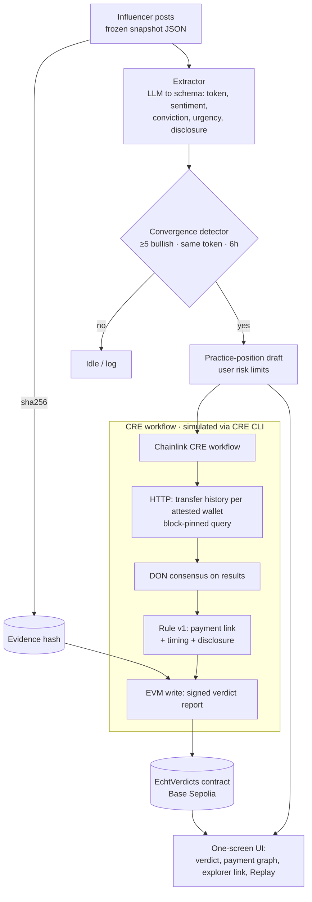

# Echt — Project Brief

**Hackathon:** BLI Legal Tech Hackathon 2 (Blockchain Legal Institute, on DoraHacks)
**Deadline:** 1 Nov 2026, 02:01 UTC+1 (Lagos). **Working deadline: Sat 31 Oct, 20:00 Lagos.**
**Build window:** 7 days (Sat 24 Oct – Sat 31 Oct)
**Targets:** Chainlink CRE bounty (2 × $1,000) · RYO-CHAN Autonomous Agents bounty ($6,000) · Legal track (LegalTech & RegTech / AI x Blockchain)

> *Echt* (German): genuine, real.
> **One line:** Before an AI agent trades on a wave of influencer hype, Echt checks on-chain whether the "independent" voices were paid by the same wallet. It cancels the trade if they were, and records the verdict on-chain through Chainlink CRE.

---

## 1. Problem

- **Paid promotion is rarely disclosed.**
  - A leaked 2025 campaign sheet showed ~160 crypto influencers accepting paid posts, with fewer than 5 labelling them as ads. Payments were linked to on-chain receipts ([The Block](https://www.theblock.co/post/368956/zachxbt-says-over-100-crypto-influencers-accepted-promo-deals-without-disclosing-paid-ads)).
  - Across 100M+ tweets, ~96% of influencer marketing posts were undisclosed ([Ershov, He & Seiler](https://causalclaims.trfetzer.com/paper/DP18554.html)).
- **Following the influencers loses money.** Tokens recommended by crypto influencers returned **−6.5% at 30 days and −18.9% at 90 days**, worst for small caps and for self-described "experts" ([ProMarket summary of Merkley, Pacelli et al.](https://www.promarket.org/2023/04/17/crypto-influencers-give-poor-investment-advice-and-the-sec-is-taking-notice/)).
- **AI trading agents make it worse.** RYO-CHAN's own brief asks agents to treat influencer convergence as a buy signal. A naive agent turns a paid pump into an automated buy, and users can't see why it bought ([Gainium forum](https://community.gainium.io/t/buying-without-a-reason/2814); [Bloomberg](https://www.bloomberg.com/news/articles/2026-05-06/ai-bots-auditioning-for-wall-street-trading-are-mostly-losing?srnd=all)).
- **The legal hook.**
  - US FTC endorsement rules require clear disclosure of a material connection in the post itself.
  - Section 17(b) of the US Securities Act prohibits touting a security without disclosing payment.
  - The evidence (posts plus on-chain payment receipts) is usually public. Nobody connects the two at the moment a decision is made.

---

## 2. Existing approaches: compare and critique

| # | Approach | Real example | How it works | Strength | Where it breaks |
|---|---|---|---|---|---|
| 1 | Manual on-chain investigation | ZachXBT's 2025 campaign exposé | A human traces payment wallets to influencer posts, often starting from a leak | Highest precision; evidence holds up | Slow, one case at a time, after the fact, depends on leaks |
| 2 | Sponsored-post text classifiers | [Zarei et al., Instagram](https://arxiv.org/pdf/2011.05757); [Ershov et al., Twitter](https://causalclaims.trfetzer.com/paper/DP18554.html) | ML on captions, hashtags and profile features (LSTM ~0.89 F1) | Scales to millions of posts | Trained on self-declared labels (noisy); 11% of manually checked flags were wrong; **never proves a payment** |
| 3 | Coordination-network detection | [Nizzoli et al.](https://ar5iv.arxiv.org/html/2001.10289) (invite-link networks + Botometer); [CooRTweet](https://ftp.fau.de/cran/web/packages/CooRTweet/readme/README.html), [Coordination Network Toolkit](https://pypi.org/project/coordination-network-toolkit/) | Graphs accounts that post the same thing within a short time window | Finds synchronized campaigns; 56% of accounts sharing crypto invite links were bots or suspended | Finds *synchrony*, not *money*; bot labels hinge on one tool and threshold; paid humans look organic |
| 4 | Social bursts matched against market moves | [Moura et al., ICWSM 2027 (Telegram)](https://arxiv.org/pdf/2609.01176) | Detects mention spikes, then tests for a price jump around the first mention | Timing separates pump-and-dumps from organic moves (median P&D message ~4 min *before* the peak) | Correlational only; no wallet data; text features did **not** separate P&D from organic posts |
| 5 | On-chain clustering and heuristics | [Bubblemaps](https://wiki.bubblemaps.io/bubblemaps-v2/how-does-it-work); [Mongardini & Mei, meme coins](https://arxiv.org/html/2507.01963v2) | Transfer-link clusters, fresh wallets, coordinated timing; threshold rules for wash trading, bundling and pump-and-dumps | Real money trails; precision-first thresholds | Says nothing about *speech*; top-250 holders only; the authors call their flags "warning signals, not proof" |
| 6 | Entity attribution | [Arkham verified vs predicted labels](https://info.arkm.com/announcements/ai-entity-predictions-are-now-live-on-arkham) | Maps addresses to identities; AI predictions shown separately from verified labels | Separates confidence levels explicitly | Predicted labels are leads, not proof; no published error rates |
| 7 | Influencer wallet leaderboards | [Kolscan / Solana Tracker](https://docs.solanatracker.io/guides/kol-tracking) | Tracks labelled influencer wallets' trades and PnL | Lets you compare what they say with what they trade | Lag; labels only as good as the attribution; neutrality questioned after Pump.fun acquired it ([Kalkine](https://kalkinemedia.com/education/guides/kolscan-how-solanas-smart-money-gets-ranked)) |

### Weak or overhyped
- **Text-only LLM "shill detectors."** Moura et al. found linguistic features don't separate pump-and-dumps from organic posts, and a fine-tuned RoBERTa matched 7–8B LLMs at ~13× the speed. A model that reads post text can't see who was paid.
- **Bot scores as proof of coordination.** One tool and one threshold decide the label, and paid humans pass as organic.
- **Predicted attribution treated as fact.** Arkham itself shows predicted labels as lower-confidence.
- **Win-rate leaderboards.** Past PnL is not predictive (Kalkine), and short time windows reward lucky streaks.

---

## 3. Principles shared by the strongest approaches

1. **Combine speech and money.** No single source works: approaches 2–4 see speech without payments, 5–7 see payments without speech. The strongest evidence, as in ZachXBT's work, is *payment, then post, then pump* in that order.
2. **Timing is the backbone.** Coordination toolkits use time windows, Bubblemaps flags wallets funded around the same time, and Moura et al. show that lead time separates pump-and-dumps from organic moves.
3. **Favor precision; output signals, not accusations.** Conservative thresholds, and wording such as "undisclosed financial link detected," never "paid shill."
4. **Keep verified and inferred attribution separate, and never upgrade one to the other.** Only attested wallets can block a trade; predicted links are advisory only.
5. **Models extract, rules decide.** Use models for messy extraction (token, sentiment, urgency). Use a deterministic, versioned rule for the verdict.
6. **Freeze and hash the inputs.** A verdict is only defensible if someone else can replay it on exactly what the system saw.
7. **Leave a path to dispute.** Arkham's dispute flow and the paper authors' "not proof" caveats both reflect this.

**Where Echt differs:** existing tools either *investigate* (manual, after the fact) or *score* (text, synchrony, or holders). Echt makes a **decision at the moment of action**: it gates an agent's trade on a payment check that the Chainlink network reaches consensus on, and writes the verdict on-chain.

---

## 4. Solution

### What the user sees (one screen)
1. **Watchlist:** 20 influencer handles. Each has a declared wallet, labelled *attested* (self-declared in bio, ENS or .sol name) or *unattested*.
2. **Convergence alert:** ≥5 watched voices go bullish on the same token within 6 hours.
3. **Draft practice position:** sized by the user's risk limits (max size, stop-loss), with the reasoning shown.
4. **Echt check:** payment lines appear from one funding wallet to the converging influencers, in the 72 hours before their posts, with no disclosure tags.
5. **Verdict:** the draft flips to `NO POSITION · undisclosed financial link (5/7)`, or stays `PROCEED` if the convergence is organic.
6. **On-chain receipt:** link to the verdict on Base Sepolia, plus a **Replay** button that recomputes the verdict from the frozen snapshot.

### Decision rule v1 (deterministic, versioned)
- **Convergence:** ≥5 distinct watched influencers, bullish, same token, within 6 hours.
- **Payment link:** an influencer's attested wallet received funds within 72 hours *before* their post from:
  - (a) the token's deployer,
  - (b) a wallet the deployer funded, or
  - (c) a wallet that also paid ≥2 other converging influencers.
- **Disclosure:** the post contains `#ad`, `#sponsored`, `paid`, or `partner`.
- **BLOCK** if ≥3 converging influencers have a payment link *and* no disclosure. Otherwise **PROCEED**, and mention any disclosed links in the reasoning.
- **Unattested wallets** can add an advisory note but can never trigger BLOCK (principle 4).

---

## 5. Architecture

### Components

| Component | Tech | Notes |
|---|---|---|
| Evidence snapshot | JSON fixtures + sha256 | Demo world of 20 pseudonymous influencers and their posts. No live X dependency. Optional later: real X pay-per-use reads (~$0.005 per post). |
| Extractor | Claude via API → JSON schema; cached | Runs once per snapshot; results are cached and hashed. Not part of the verdict logic. |
| Convergence + agent | TypeScript service | Deterministic; produces the RYO-style practice position and reasoning. |
| **CRE workflow** | CRE TypeScript SDK + CLI | **HTTP** to a transfer-history API (Etherscan V2 for Base Sepolia, or Alchemy `getAssetTransfers`), one call per converging wallet plus the funder's lineage, **≤10 of the 15-call limit**. Every query pins `endblock` so all oracle nodes see identical data. API key held in CRE secrets. Then **consensus**, rule v1 inside the workflow, and an **EVM write** of the signed report. |
| Verdict contract | Solidity (Foundry), receiver contract per CRE docs | Stores `evidenceHash, tokenAddr, ruleVersion, convergingCount, linkedCount, funder, decision, influencerIdHashes[]`. Influencers are stored as `keccak256(handle)`, never plaintext. |
| Demo chain state | Base Sepolia | A test token is deployed; the deployer funds a "marketing" wallet, which pays 5 of 7 influencer wallets; 2 organic influencers are unpaid. All real testnet transactions. |
| UI | Vite + React, one page | Watchlist → alert → draft → payment graph → verdict → explorer link → Replay. |
| Reasoning trail | Hash-chained JSON log | Each step records an input hash, the rule fired, and its output. This is the "repeatable reasoning trail" the RYO bounty asks for. |

### Why this design fits CRE's real limits

| CRE limit (from the [CRE docs](https://docs.chain.link/cre/go/llms-full.txt)) | Design response |
|---|---|
| 15 HTTP calls per run, 250 KB per response | Only converging wallets are checked; queries are bounded by block range |
| EVM historical log reads cover only 100 blocks | Transfer history comes over HTTP, not on-chain log reads |
| Deploying needs approval | A **CLI simulation** qualifies for the bounty, and the simulation writes on-chain for real; request deploy access on day 1 as a bonus |
| Ethereum writes can fail around Glamsterdam upgrades | Use Base Sepolia, not Ethereum Sepolia |
| Code must be deterministic | Fixed `endblock`, sorted inputs, no `Date.now()` |

---

## 6. Fit with the hackathon

| Requirement | How Echt meets it |
|---|---|
| **Chainlink:** CRE workflow is the orchestration layer, connects a chain to an external API, CLI simulation or deployment | The CRE workflow *is* the verdict engine: HTTP to a transfer-history API, consensus, rule, EVM write |
| **RYO-CHAN:** agents read market evidence, record practice trades, show cause and effect, keep a repeatable reasoning trail; Multi-KOL Narrative spotlight | Watches 20 influencers, detects convergence, drafts a practice position under user risk limits; the trade is gated by evidence; hash-chained trail plus Replay |
| **BLI legal theme** | Turns disclosure law (FTC material-connection rule, Securities Act §17(b)) into an automated check that produces evidence; wording avoids defamation; influencer IDs are hashed on-chain |
| **BLI deliverables** (public repo, architecture doc, video demo) | Covered in section 9 |

---

## 7. 90-second silent demo script

| Time | On screen |
|---|---|
| 0–10s | Title card: "20 voices. One wallet?" Watchlist of 20 influencers |
| 10–25s | Posts arrive; convergence alert: 7 bullish on `$MOON` in 2h |
| 25–35s | Agent drafts a practice long: size, stop, reasoning |
| 35–50s | Echt check runs (CRE simulation log in a side pane) |
| 50–65s | **Payment graph lights up:** one funder → 5 of 7 influencer wallets, 24–48h before their posts, no `#ad` |
| 65–75s | Draft flips to **NO POSITION · undisclosed financial link (5/7)** |
| 75–85s | Explorer link opens: verdict transaction on Base Sepolia |
| 85–90s | Replay: same snapshot, same verdict. End card: "Echt — was that call real?" |

**Memorable moment:** five "independent" influencers all tracing back to one wallet, and the trade cancelling itself.

---

## 8. Seven-day plan

| Day | Date | Deliverable | Done when |
|---|---|---|---|
| 1 | Sat 24 – Sun 25 | CRE CLI installed; hello-world simulated; deploy access requested; contract scaffolded; Base Sepolia scenario seeded (token, funder, 7 wallets, payments) | Scenario transactions visible on the explorer |
| 2 | Mon 26 | Snapshot fixtures (20 influencers); extractor + cache; convergence detector; agent draft | Running on the snapshot produces the alert and draft |
| 3 | Tue 27 | **CRE workflow:** HTTP transfers → consensus → rule v1 → EVM write | `cre workflow simulate` writes a verdict on-chain |
| 4 | Wed 28 | Single-page UI + payment graph + Replay | End-to-end demo runs locally |
| 5 | Thu 29 | Organic-case test (PROCEED), failure fallbacks, recorded backup run, architecture doc | Both verdict paths verified on-chain |
| 6 | Fri 30 | 90-second video, README, DoraHacks BUIDL, applications to both bounties | Draft submission saved |
| 7 | Sat 31 | Buffer, polish, **submit by 20:00 Lagos** | Submitted |

**Decision checkpoint, end of Day 3:** if the CRE workflow can't write a verdict, cut scope to a CRE workflow that verifies a single wallet. The fallback idea (Cite or Strike) is only worth switching to if transfer data is unobtainable.

---

## 9. Submission checklist
- [ ] Public GitHub repo (README with setup, `cre workflow simulate` command, contract addresses)
- [ ] Architecture doc (this diagram + rule v1 + CRE limits table)
- [ ] 90-second demo video (silent-readable, captions on)
- [ ] Explorer links: scenario transactions + BLOCK verdict + PROCEED verdict
- [ ] CRE simulation output log committed
- [ ] DoraHacks BUIDL; apply to **both** bounties; contact field filled (Discord/WhatsApp)
- [ ] Disclaimer: practice positions only, no real trades; demo world uses synthetic influencers

---

## 10. Risks

| Risk | Impact | Mitigation |
|---|---|---|
| CRE learning curve / CLI setup | Delays everything | Day 1 is setup only; start from a CRE template |
| Transfer API doesn't support Base Sepolia, or rate-limits | Breaks the check | Check Etherscan V2 on Day 1; Alchemy `getAssetTransfers` as backup; cached responses for the demo |
| Oracle nodes see different API results | Consensus fails | Pin `endblock`; sort results; compare only aggregated fields |
| LLM extraction varies between runs | Verdict changes on replay | Extraction is cached and hashed; the verdict reads the cache, never a live model |
| Defamation / ToS concerns | Legal judges mark it down | Synthetic demo world; hashed IDs on-chain; "undisclosed financial link" wording; no real X scraping in the demo |
| RYO prize paid in an unlaunched token, or unclear | Lower payoff | Echt still qualifies for the CRE bounty and the legal track |
| Glamsterdam upgrade write failures | On-chain write fails live | Base Sepolia; recorded fallback run |

---

## 11. Out of scope
Live X streaming · Discord/Telegram sources · real trades or wallets with real funds · multiple tokens per run · ML classifiers · on-chain disputes (mention as roadmap) · mainnet.

## 12. Roadmap (pitch only)
Live X ingestion at about $0.005 per post · influencers claim and attest their wallets themselves (making attestation opt-in and verifiable) · a dispute path where an influencer submits proof of disclosure · integration with Chainlink ACE policies when access opens · an API for trading terminals such as RYO-CHAN's.

---

## Sources
- The Block — ZachXBT on 160 undisclosed promos: https://www.theblock.co/post/368956/zachxbt-says-over-100-crypto-influencers-accepted-promo-deals-without-disclosing-paid-ads
- Ershov, He & Seiler — undisclosed influencer marketing on Twitter: https://causalclaims.trfetzer.com/paper/DP18554.html
- ProMarket — crypto influencer returns study: https://www.promarket.org/2023/04/17/crypto-influencers-give-poor-investment-advice-and-the-sec-is-taking-notice/
- Zarei et al. — detecting sponsored Instagram posts: https://arxiv.org/pdf/2011.05757
- Nizzoli et al. — online cryptocurrency manipulation: https://ar5iv.arxiv.org/html/2001.10289
- Moura et al. — Telegram-driven crypto manipulation (ICWSM 2027): https://arxiv.org/pdf/2609.01176
- Mongardini & Mei — meme coin manipulation: https://arxiv.org/html/2507.01963v2
- Bubblemaps — how clustering works: https://wiki.bubblemaps.io/bubblemaps-v2/how-does-it-work
- Arkham — AI entity predictions: https://info.arkm.com/announcements/ai-entity-predictions-are-now-live-on-arkham
- Solana Tracker — KOL tracking: https://docs.solanatracker.io/guides/kol-tracking
- Kalkine — Kolscan explained: https://kalkinemedia.com/education/guides/kolscan-how-solanas-smart-money-gets-ranked
- CooRTweet: https://ftp.fau.de/cran/web/packages/CooRTweet/readme/README.html
- Coordination Network Toolkit: https://pypi.org/project/coordination-network-toolkit/
- Chainlink CRE docs (limits, simulation, deploy access): https://docs.chain.link/cre/go/llms-full.txt
- Chainlink CRE templates: https://docs.chain.link/cre/templates
- RYO-CHAN Autonomous Agents bounty: https://dorahacks.io/hackathon/bounty/1380
- Chainlink CRE bounty: https://dorahacks.io/hackathon/bounty/1362
- BLI hackathon announcement (deliverables): https://bli.tools/international-hackathon-with-ryo-digital-chainlink-labs-focuses-on-ai-payrails-stablecoins-more/
- Gainium forum — bot bought without signal: https://community.gainium.io/t/buying-without-a-reason/2814
- Bloomberg — AI trading bots mostly losing: https://www.bloomberg.com/news/articles/2026-05-06/ai-bots-auditioning-for-wall-street-trading-are-mostly-losing
- X API pricing 2026: https://www.postproxy.dev/blog/x-api-pricing-2026/
